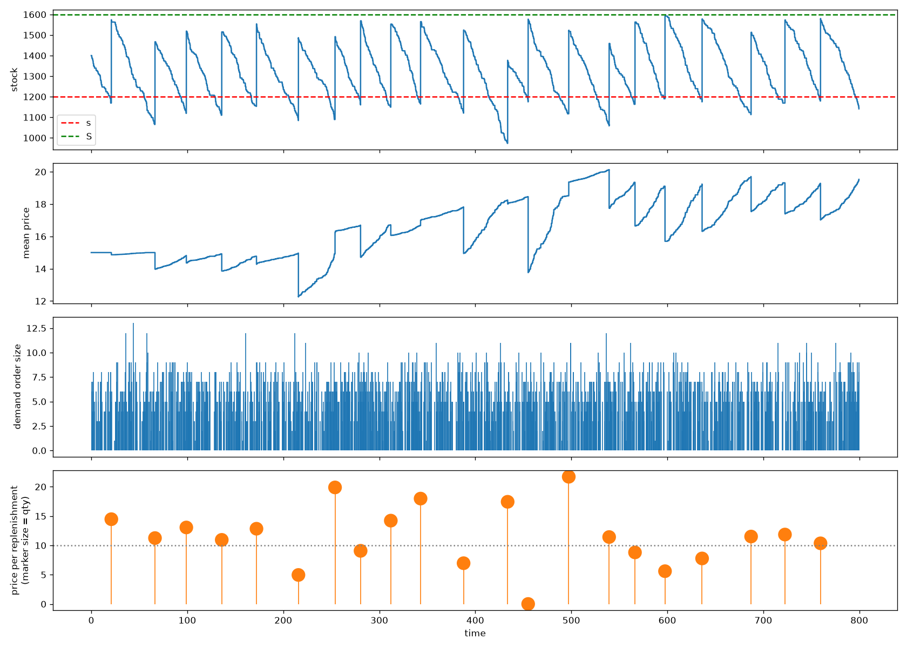

# stock-simulation

A discrete-event simulation of a single-item inventory, built with [SimPy](https://simpy.readthedocs.io/), plus a short paper on what the simulation shows.

## What it models

- **Stock** is held in lots. Each lot has one quantity and one unit price.
- **Demand** arrives as a Poisson process. Order sizes are `Normal(mu, sigma)`, rounded up to at least 1.
- **Issuing** is cheapest-first: demand is served from the lowest-priced lot, then the next.
- **Replenishment** follows an `(s, S)` policy with `s = S * (1 - empty_trigger)`. When the inventory position (on hand + on order) falls to `s` or below, an order of `S - position` items is placed. It arrives after an exponential lead time as one lot with a random unit price.
- **Mean price** per item in stock (`V / N`) is recorded after every stock change. Demand orders and replenishments are logged too.

## Finding

Under cheapest-first issuing, the mean price of the stock drifts upward. In the default run it reaches about 20, although lot prices are drawn around 10. Cheap lots are consumed right after delivery, while expensive lots stay in stock. The mean price therefore reflects the items nobody took, not the purchase price, and it is not usable as a cost basis. See `paper.pdf` for the full analysis and alternatives (FIFO/LIFO, moving-average cost, tracking issued prices).



## Setup

```sh
python3 -m venv .venv
source .venv/bin/activate
pip install -r requirements.txt
```

## Run

```sh
python inventory_sim.py                  # cheapest-first (default)
python inventory_sim.py --issuing fifo
python inventory_sim.py --issuing lifo
```

This prints a table of stock level and mean price over time, plus summary statistics (end stock, lost demand, mean price). It also saves the four-panel plot to `inventory_sim.png` (`inventory_sim_fifo.png` / `inventory_sim_lifo.png` for the other strategies): stock level, mean price, demand order sizes, and replenishment prices.

## Parameters

Edit the `Params` dataclass in `inventory_sim.py`, or pass your own to `run()`:

| Parameter | Default | Meaning |
|---|---|---|
| `sim_time` | 800 | Simulated time |
| `demand_rate` | 2.0 | Demand orders per time unit |
| `order_mean`, `order_std` | 5.0, 2.0 | Order size distribution |
| `S` | 1600 | Order-up-to level (capacity) |
| `empty_trigger` | 0.25 | Fraction empty that triggers a re-order (`s = 1200`) |
| `lead_time_mean` | 5.0 | Mean lead time (exponential) |
| `lead_time_fixed` | `None` | Set to use a fixed lead time instead |
| `initial_stock`, `initial_price` | 1400, 15.0 | Starting lot |
| `price_mean`, `price_std` | 10.0, 5.0 | Lot price distribution |
| `seed` | 42 | Random seed (`None` for a random run) |
| `issuing` | `cheapest_first` | Lot selection strategy: `cheapest_first`, `fifo`, `lifo`, or your own `list[Lot] -> Lot` function |

```python
from inventory_sim import Params, run

inv = run(Params(seed=1, S=2000))
print(inv.count, inv.mean_price(), inv.unmet)
```

`run()` returns an `Inventory` with `history`, `demand_orders`, `replenishments`, `demanded` and `unmet`.

## Paper

`paper.tex` describes the model, how the mean price is computed, and why it is biased. Build it with:

```sh
latexmk -pdf paper.tex
```

It includes `inventory_sim.png`, so run the simulation first if you changed parameters.
